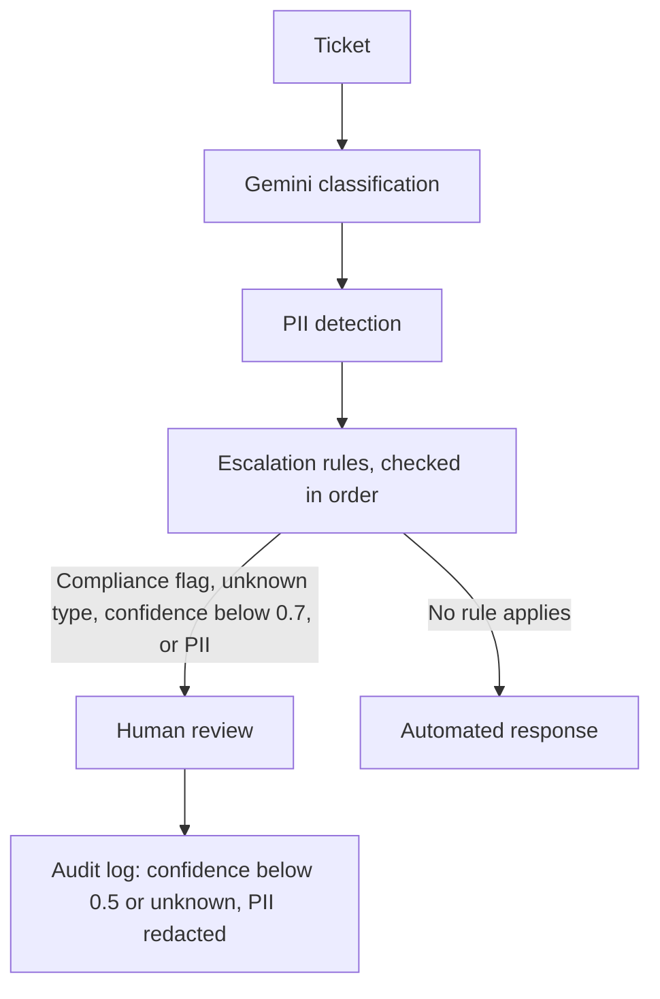

# Vigil - ISO/IEC 42001 Governance Prototype

*AI that knows when not to trust itself.*

Vigil is a governed support system that will not automate a ticket it does not trust. It reads incoming tickets, and when confidence is low, when personal data is present, or when the type is unknown or a compliance flag is raised, it sends the ticket to a human by rule in the code, not by the model's choice. Classification is the job underneath. Refusal is the point.

Tested on 26 real tickets: 88.5% right, every piece of personal data caught, every mistake sent to a human.

Built with Google Gemini 3.8 Flash to demonstrate practical application of AI management system requirements.

## Why "Vigil"?

A vigil is keeping watch through the night: alert, patient, ready to act, but never acting prematurely. That is what this system does. It does not just classify tickets. It watches every decision, including its own confidence, and the moment something looks wrong (low confidence, PII, an unknown ticket type), it stops and hands off to a human. The name is the philosophy: AI that knows when not to trust itself.

---

## Why This Matters

Many AI systems focus on maximizing automation.

Vigil demonstrates a different approach: automate when confidence is justified, escalate when risk increases, and keep a redacted record of the cases it was unsure about.

The goal is not to eliminate human oversight. The goal is to make human oversight systematic.

---

## How It Works



Every check can divert the ticket to a human. The escalation rules are enforced in code (`governance/config/scope.yaml`), not left to the model's judgment.

---

## Evaluation

Evaluated on 26 author-labeled tickets with gemini-3.8-flash (2026-11-01). Full results in `docs/evaluation_results.md`.

- **Accuracy:** 23 of 26 (88.5%)
- **PII detection recall:** 6 of 6 (100%)
- **Escalated to human review:** 10 of 26 (38.5%)
- **Every miss routed to a human.** The 3 misclassified tickets were all PII-heavy, and each one hit an escalation rule and went to human review. The misses cost accuracy, not safety.

Limitations: labels were assigned by the author, not independent labelers, and 26 tickets is a small sample. Treat this as a first measurement, not a benchmark.

---

## Current Features

- **Escalation rules enforced in code** (`governance/config/scope.yaml`): compliance flags, unknown ticket types, confidence below 0.7 (human-routing threshold), and PII all route to a human
- **Governance Framework** with JSONL logging, audit procedures, and ISO/IEC 42001 documentation
- **PII Detection** (`risk_controls/pii_filters.py`) with regex patterns and Luhn algorithm validation
- **LLM Classification Engine** (`bot_engine/router.py`) using Gemini 3.8 Flash with configurable confidence scoring and error handling
- **Centralized Configuration** (`governance/config/scope.yaml`) for system settings, ticket types, and model parameters
- **Pytest Suite** (`tests/`) covering classification logic, PII detection, and edge cases
- **Graphical User Interface** (`main_gui.py`) for interactive ticket classification
- **Standalone Executable** capability via PyInstaller for cross-platform distribution

---

## Getting Started

### Prerequisites

- Python 3.11+
- A Gemini API key (set as environment variable `GEMINI_API_KEY`)
  - Free tier supported (limits are low and per-project; check your quota in Google AI Studio)
  - Get your key at: https://aistudio.google.com/apikey

### Installation

1. **Clone the Repository:**
```bash
   git clone https://github.com/Micouwr/Vigil.git
   cd Vigil
```

2. **Create Virtual Environment:**
```bash
   # Windows
   python -m venv venv
   venv\Scripts\activate

   # Mac/Linux
   python3 -m venv venv
   source venv/bin/activate
```

3. **Install Dependencies:**
```bash
   pip install --upgrade pip
   pip install -r requirements.txt
```

4. **Configure API Key:**
   Create a `.env` file in the project root:
```
   GEMINI_API_KEY=your_actual_api_key_here
```

5. **Verify Installation:**
```bash
   python -c "from bot_engine.router import classify_ticket; print('Backend OK')"
```
   If no API key is configured yet, the import also prints an `Error: Gemini API key not configured` line. That is expected at this step; the `Backend OK` line is the check that matters. Set `GEMINI_API_KEY` in `.env` before classifying tickets.

---

## Running the Application

### GUI Application
```bash
python main_gui.py
```

This launches the Vigil GUI where you can:
- Enter ticket text
- View classification results with confidence scores
- See PII detection flags

---

## Building Standalone Executable

### Windows
```bash
pyinstaller --onefile --windowed ^
  --add-data "governance;governance" ^
  --add-data "prompts;prompts" ^
  --name "Vigil" ^
  main_gui.py
```

### Mac/Linux
```bash
pyinstaller --onefile --windowed \
  --add-data "governance:governance" \
  --add-data "prompts:prompts" \
  --name "Vigil" \
  main_gui.py
```

**Output Location:** `dist/Vigil` (or `.exe` on Windows)

---

## Running Tests
```bash
# Run all tests
python -m pytest

# Run with verbose output
python -m pytest -v

# Run specific test file
python -m pytest tests/test_router.py -v

# Run with coverage report
pip install pytest-cov
python -m pytest --cov=bot_engine --cov=risk_controls --cov-report=html
```

---

## Project Structure
```
Vigil/
├── bot_engine/
│   ├── __init__.py
│   ├── README.md                    # Engine documentation
│   └── router.py                    # Core classification logic
├── risk_controls/
│   ├── __init__.py
│   ├── README.md                    # Risk controls documentation
│   ├── escalation_protocols.md      # Escalation procedures
│   ├── fallback_protocols.md        # Fallback handling procedures
│   └── pii_filters.py               # PII detection with Luhn algorithm
├── governance/
│   ├── __init__.py
│   ├── README.md                    # Governance documentation index
│   ├── ai_policy.md                 # AI policy statement
│   ├── audit_procedures.md          # Audit framework
│   ├── competence_requirements.md   # Training requirements
│   ├── roles_and_responsibilities.md # Role definitions
│   ├── config/
│   │   └── scope.yaml               # System configuration
│   └── training_materials/
│       ├── admin_technical_guide.md
│       ├── governance_framework.md
│       └── reviewer_handbook.md
├── docs/
│   ├── README.md                    # Documentation index
│   ├── DESIGN_NOTES.md              # Threshold design notes
│   ├── iso42001_compliance_mapping.md # ISO/IEC 42001:2023 compliance mapping
│   ├── operator_quick_guide.md      # User guide
│   ├── PORTFOLIO.md                 # Project portfolio
│   ├── eval_tickets.json            # Labeled tickets used for evaluation
│   └── evaluation_results.md        # Live-model evaluation write-up
├── tests/
│   ├── __init__.py
│   ├── README.md                    # Testing documentation
│   ├── test_router.py               # Router tests
│   └── test_pii_filters.py          # PII detection tests
├── tools/
│   ├── README.md                    # Tools documentation
│   └── fallback_viewer.py           # Log analysis tool
├── prompts/
│   ├── README.md                    # Prompt documentation
│   └── classification_prompt.txt    # LLM prompt template
├── lifecycle/
│   ├── README.md                    # Lifecycle documentation
│   └── versionhistory.md            # Version tracking
├── main_gui.py                      # GUI application
├── requirements.txt                 # Python dependencies
├── .env                             # API key (create this, not in repo)
├── .gitignore
└── README.md                        # This file
```

---

## Configuration

### Main Configuration File

**Location:** `governance/config/scope.yaml`

Key settings:
- `confidence_threshold`: Audit threshold (default: 0.5). Predictions scored below this are written to the fallback log for audit. This is separate from the routing threshold below.
- `model_name`: AI model to use (default: "gemini-3.8-flash")
- `ticket_types`: List of classification categories
- `escalation_rules`: Rules for human escalation, including routing anything with confidence below 0.7 to a human

Two different thresholds, two different jobs. The 0.5 audit threshold decides what gets logged. The 0.7 routing threshold decides what goes to a human. Both are initial operating values, not derived from production data. They separate "uncertain" from "confident" behavior until real ticket volume is available for calibration.

### Ticket Categories

- `access_request` - User needs access to systems/files
- `password_reset` - Password or login issues
- `software_issue` - Application problems
- `hardware_issue` - Equipment problems
- `billing_question` - Invoice or payment inquiries
- `compliance_flag` - Legal, security, or policy concerns
- `unknown` - Unable to determine category

---

## Monitoring and Logs

### Log Files

| File | Purpose | Location |
|------|---------|----------|
| `fallback_log.jsonl` | Low-confidence classifications | Project root |
| `governance/llm_error_log.jsonl` | API errors and failures | `governance/` |

### Using the Fallback Viewer
```bash
# View all entries
python tools/fallback_viewer.py

# View last 7 days
python tools/fallback_viewer.py --date-range 7

# View summary statistics only
python tools/fallback_viewer.py --stats-only

# Filter by confidence score
python tools/fallback_viewer.py --max-confidence 0.3

# Export to CSV
python tools/fallback_viewer.py --export report.csv
```

**See:** `tools/README.md` for detailed usage instructions

---

## ISO/IEC 42001:2023 Compliance

This system implements governance controls aligned with ISO/IEC 42001:2023:

### Clause Mapping

| ISO Clause | Implementation | Evidence |
|------------|----------------|----------|
| **Clause 4** - Context | System scope and stakeholder identification | `governance/config/scope.yaml` |
| **Clause 5** - Leadership | Policy and role definitions | `governance/ai_policy.md`, `governance/roles_and_responsibilities.md` |
| **Clause 6** - Risk Management | PII detection, confidence thresholds, fallback logging | `risk_controls/pii_filters.py`, `bot_engine/router.py` |
| **Clause 7** - Transparency | Confidence scores, audit logs, training materials | `main_gui.py`, logs, `docs/`, `governance/training_materials/` |
| **Clause 8** - Operations | Configuration management, escalation rules, testing | `governance/config/scope.yaml`, `tests/` |
| **Clause 9** - Performance | Monitoring tools, audit procedures | `tools/fallback_viewer.py`, `governance/audit_procedures.md` |
| **Clause 10** - Improvement | Feedback mechanisms, version control | `governance/training_materials/reviewer_handbook.md` |

**Full Compliance Documentation:** See `docs/iso42001_compliance_mapping.md` for comprehensive clause-by-clause mapping (93.4% compliant)

---

## Training and Documentation

### For Operators
- **Quick Start:** `docs/operator_quick_guide.md`
- **Competence Requirements:** `governance/competence_requirements.md`

### For Review Agents
- **Review Handbook:** `governance/training_materials/reviewer_handbook.md`

### For Administrators
- **Technical Guide:** `governance/training_materials/admin_technical_guide.md`

### For Governance Leads
- **Governance Framework:** `governance/training_materials/governance_framework.md`
- **Audit Procedures:** `governance/audit_procedures.md`

### Project Portfolio
- **Portfolio Document:** `docs/PORTFOLIO.md`

**See:** `docs/README.md` for complete documentation index

---

## Security Considerations

### API Key Management
- Store API key in `.env` file only
- Never commit `.env` to version control
- Verify `.env` is listed in `.gitignore`
- Use different keys for dev/staging/prod environments
- Free tier rate limits: low and per-project (recent AI Studio figures for gemini-3.8-flash are about 5 requests per minute and 20 per day); check your quota in Google AI Studio

### PII Protection
- Fallback logs may contain PII
- Restrict log file access to authorized personnel only
- Follow organizational data privacy procedures
- Implement log retention and secure deletion policies

### Access Controls
```bash
# Linux/Mac: Restrict sensitive files
chmod 600 .env
chmod 640 fallback_log.jsonl
chmod 640 governance/llm_error_log.jsonl
```

---

## Troubleshooting

### Common Issues

**Issue: "Gemini API key not configured" (or "Gemini client is not initialized")**
- **Solution:** Verify `.env` file exists with valid `GEMINI_API_KEY`

**Issue: Rate limit exceeded**
- **Solution:** Free tier allows only a small number of requests per day. If you hit the limit, wait until the quota resets (midnight Pacific) or upgrade the API plan.

**Issue: High fallback rate (>40%)**
- **Solution:** Review `governance/config/scope.yaml` and consider adjusting `confidence_threshold`

**Issue: PII false positives**
- **Solution:** Review patterns in `risk_controls/pii_filters.py` and add test cases

**Issue: Application freezes**
- **Solution:** Check network connection and API response times

**For detailed troubleshooting:** See `governance/training_materials/admin_technical_guide.md`

---

## Development Roadmap

### Completed
- ✅ Core classification engine with Gemini 3.8 Flash
- ✅ Escalation rules enforced in code, including unknown-to-human routing
- ✅ PII detection with Luhn validation and redaction in fallback logs
- ✅ Basic GUI prototype for interactive ticket classification
- ✅ Comprehensive test suite (43/43 passing - 100%)
- ✅ ISO/IEC 42001:2023 governance framework (93.4% compliant)
- ✅ Training materials and documentation
- ✅ Fallback log viewer tool
- ✅ Migration to modern Google GenAI SDK (`google-genai`)
- ✅ CI pipeline running the test suite on every push

### In Progress
- None currently

### Planned
- [ ] Reviewer dashboard: plain-language handoff reasons and recorded reviewer decisions, closing the loop after handoff
- [ ] Screen-recorded demo video
- [ ] Additional PII patterns (international formats)
- [ ] Performance benchmarking suite
- [ ] Integration adapters (Zendesk, Freshdesk, Slack)
- [ ] Enhanced error recovery mechanisms
- [ ] Multi-model support (Gemini + OpenAI)

---

## Feedback

This is a personal portfolio project demonstrating ISO/IEC 42001 governance controls in a working AI system. 

If you notice issues or have suggestions:
1. Check existing issues in the repository
2. Create a detailed issue report
3. Include steps to reproduce (if applicable)

---

## License

**Custom Portfolio & Evaluation License**

Copyright (c) 2025 William Ryan Micou. All Rights Reserved.

This software is provided for demonstration, portfolio, and evaluation purposes.

**Permitted Uses:**
- ✅ Viewing and reviewing for employment consideration
- ✅ Technical assessment and code review
- ✅ Educational and academic study
- ✅ Reference for ISO/IEC 42001:2023 implementation learning

**Restricted Uses (Require Written Permission):**
- ❌ Commercial use or production deployment
- ❌ Modification or derivative works
- ❌ Redistribution or sublicensing

For commercial licensing inquiries, contact: **micouwr2025@gmail.com**

See [LICENSE](LICENSE) file for complete terms.

---

## Contact

**System Owner:** William Ryan Micou  
**Repository:** https://github.com/Micouwr/Vigil  
**Email:** micouwr2025@gmail.com

---

## Acknowledgments

- **Google Gemini API** - LLM classification engine (Gemini 3.8 Flash)
- **ISO/IEC 42001:2023** - AI Management Systems standard framework
- **NIST AI RMF** - Risk management guidance


